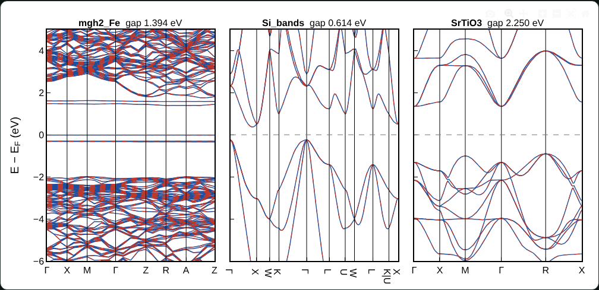

# Summary

Computer simulations based on density functional theory [@hohenberg1964; @kohn1965] predict how electrons behave in materials and molecules, and are used to design batteries, catalysts and hydrogen-storage compounds. The raw results of these simulations, however, are large text and binary files whose format depends on the program that produced them. `BrUMaRe` (*Brillouin-zone Utilities for Materials Research*) turns these files into the figures, tables and quantities that scientists need: electronic band structures, densities of states, charge-density maps, the local structure around defects and their formation thermodynamics. It reads the outputs of five widely used programs, CASTEP [@clark2005castep], VASP [@kresse1996vasp], SIESTA [@soler2002siesta], Quantum ESPRESSO [@giannozzi2017] and ORCA [@neese2020], and analyses all of them in the same way. The same analysis runs as a web page that needs no installation and sends no data to any server, as a desktop application that works offline, and as a command-line program for computing clusters.

# Statement of need

A typical first-principles study uses several post-processing tools, each tied to one code or one task, and silent differences between them (the energy reference of a band plot, the units of a density grid, whether the Fermi level was recomputed) are a common source of error. Comparing results from different codes in one consistent framework is rarely possible, and figures are often published without citing every method that produced them. `BrUMaRe` addresses researchers and students in computational materials science, condensed-matter physics and quantum chemistry who need publication-ready analyses of heterogeneous outputs. Its design principles are: one data model for all codes; the Fermi energy written by the code is never recomputed (by default energies are shown on the original scale with the Fermi level marked); identical results in the three front-ends; and reproducibility, with every figure accompanied by plain-text data and every session able to export a BibTeX file listing the software, the codes and the methods actually used.

# State of the field

Excellent tools exist for parts of this workflow. sumo [@ganose2018sumo] and pymatgen [@ong2013pymatgen] produce band structures and densities of states mainly from VASP; VASPKIT [@wang2021vaspkit] automates VASP workflows; VESTA [@momma2011vesta] visualises structures and densities; the Bader program [@henkelman2006; @tang2009bader] partitions charges; c2x [@rutter2018c2x] converts CASTEP formats; cclib [@oboyle2008cclib] parses quantum-chemistry outputs. None of them combines, for several plane-wave, localised-basis and molecular codes, the electronic analysis with defect geometry, distortion indices [@robinson1971; @baur1974; @hoppe1979], defect and hydride thermodynamics [@freysoldt2014], density-difference descriptors and cross-code comparison, in a zero-installation interface with an equivalent command-line counterpart. Contributing these features to an existing package was considered, but each existing tool is organised around a single code family or a single task, while the central requirement here was a code-agnostic data model shared by an in-browser implementation and a dependency-light Python program.

# Software design

Readers specific to each code and file type convert every output to a common representation (eigenvalues in Hartree, reciprocal lattice in Bohr$^{-1}$, structures in Å, densities in e Å$^{-3}$). In Python, non-CASTEP inputs are registered in an in-memory virtual file registry that mimics the CASTEP file set, so new codes were added without modifying the analysis pipeline, and byte-by-byte regression of CASTEP outputs guarded every change. The web application is a single self-contained HTML file using Plotly.js; the desktop application embeds the same document through pywebview [@pywebview]; the command-line program is one Python file depending only on numpy [@harris2020numpy] and matplotlib [@hunter2007matplotlib], which eases deployment on clusters. The main trade-off was maintaining two implementations (JavaScript and Python) of the same specification in exchange for zero-installation use in the browser and scriptable use on clusters; parity is verified by running both on the same inputs. Band edges are obtained by electron counting, effective masses by parabolic fits, charges by Voronoi [@voronoi1908; @gellatly1982] and on-grid Bader partitions [@henkelman2006], and an optional scissor or empirical PBE-to-G$_0$W$_0$ correction [@morales2017] addresses the band-gap underestimation of semilocal functionals while always reporting the original gap. A Brillouin-zone module builds the Wigner–Seitz cell of the reciprocal lattice from Bragg planes on an LLL-reduced basis [@lenstra1982], recognises the lattice type from the shape of the zone, labels high-symmetry points following @setyawan2010 and writes ready-to-use k-paths for CASTEP, VASP, Quantum ESPRESSO and SIESTA (SeeK-path [@hinuma2017] is recommended for low-symmetry lattices); space groups are determined with moyo [@moyo], the successor of spglib [@togo2024spglib], through identical Python and WebAssembly builds, structures can be read from CIF, POSCAR and other formats, a library of 51 literature materials is included, and all 14 Bravais lattices follow the Setyawan–Curtarolo convention, checked point by point against pymatgen. The interface, help and tutorial are available in six languages.

# Research impact statement

`BrUMaRe` was developed for, and is used in, a study of transition-metal-substituted MgH$_2$ for solid-state hydrogen storage [@macedo2025tcc; @sakintuna2007]. It was validated with public outputs from the test suites of pymatgen, sisl, Quantum ESPRESSO and cclib: the PBE gap of Si (0.614 eV, indirect) and its longitudinal electron mass (0.94 $m_e$, experiment 0.92 $m_e$), the 20 $\mu_B$ moment of ferromagnetic Fe$_2$O$_3$, the indirect R$\to\Gamma$ gap of SrTiO$_3$ with crystal-field-split Ti 3d states, and the HOMO–LUMO gap of divinylbenzene from ORCA. The browser and command-line implementations give identical numbers. On the same files, band gaps, Fermi energies and orbital energies agree with pymatgen, sumo, sisl and cclib to the printed precision, and refined Bader charges agree with pybader within 0.001 e per atom; electron counting avoids the spurious metallic classification (zero gap) that a 0.04 meV numerical crossing of the CASTEP Fermi level causes in E_F-based tools, and a fit with a linear term recovers the Si electron mass (0.94 $m_e$, experiment 0.92 $m_e$) where a parabola anchored at the sampled k-point gives 0.68–1.54 $m_e$. An automated pytest suite (80 tests) runs under continuous integration. The software is freely available as a web application, a Python package and a Windows installer.

# AI usage disclosure

Generative AI (Anthropic's Claude) was used extensively to help write and refactor parts of the JavaScript and Python code, to translate the interface and tutorial, to draft documentation and to draft and edit this paper. The scientific scope, methods, equations and requirements were defined by the author. All AI-assisted code was reviewed and verified by the author through comparison with real outputs of the five supported codes, cross-checking of the two implementations and byte-by-byte regression of CASTEP outputs. The author takes full responsibility for the software and this paper.

# Acknowledgements

The author thanks Benedet, R. O., without whom this work would never have happened, Prof. J. R. C. Salgado and Prof. R. S. da Lapa for supervision, and CNPq (Brazil) for a master's scholarship.

# References
